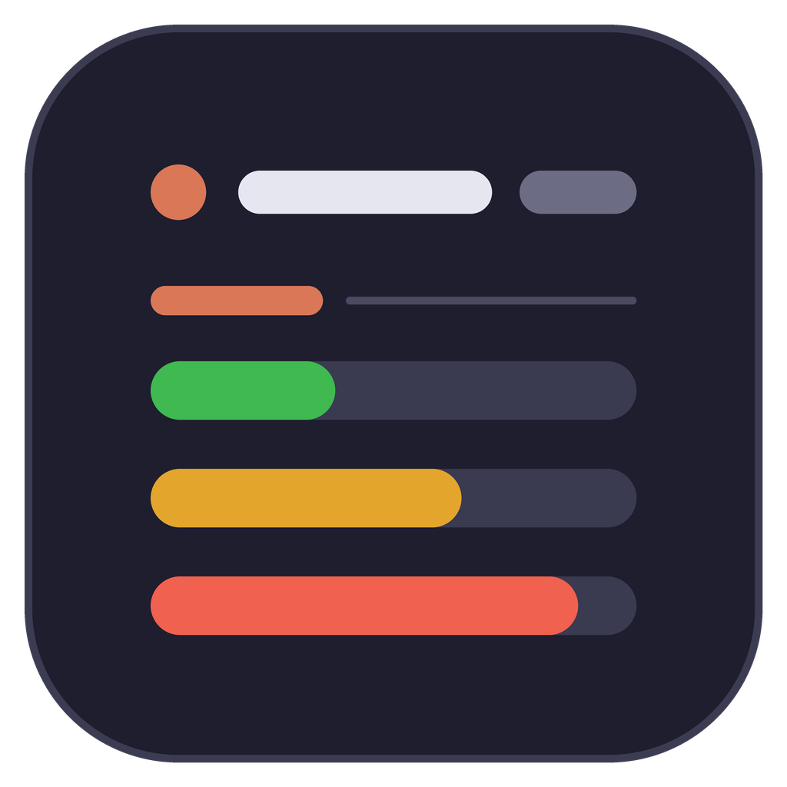
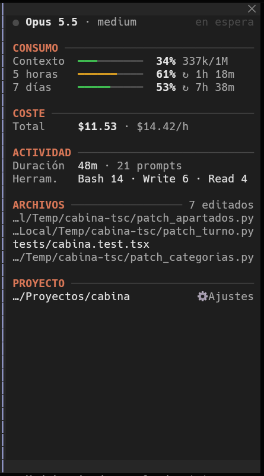
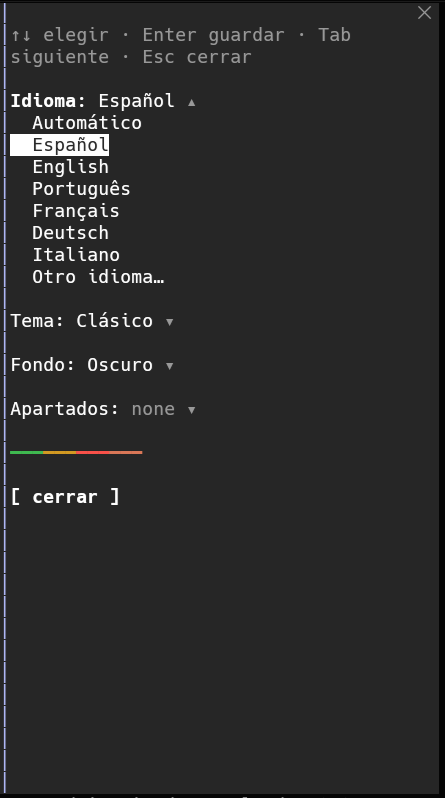
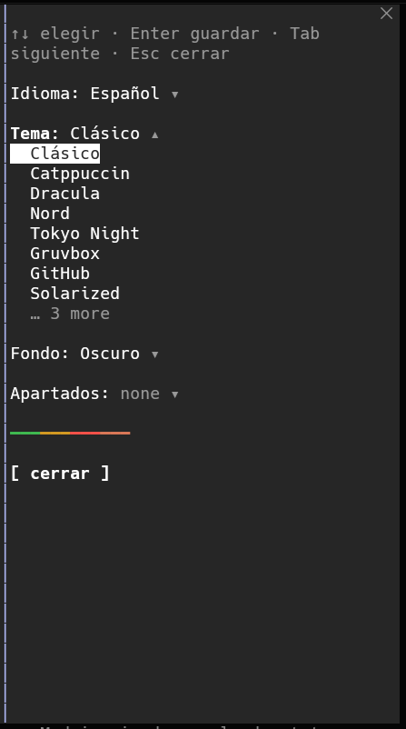
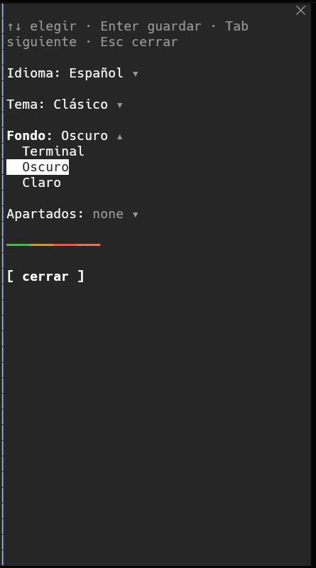
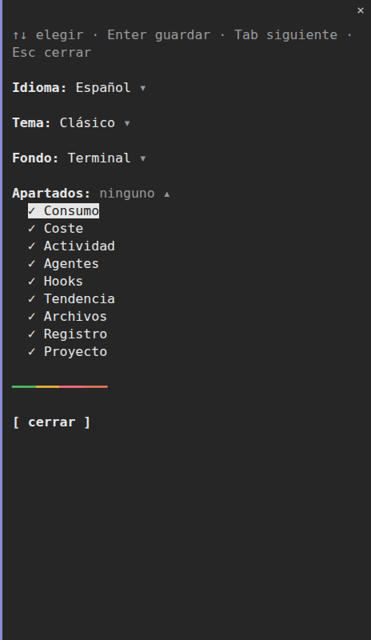

<p align="center"></p>

<h1 align="center">Cabina</h1>

<p align="center"><strong>Un panel lateral limpio para Claude Code: todo lo que hace tu sesión, de un vistazo.</strong></p>

<p align="center">
  
  
  <a href="LICENSE"></a>
</p>

<p align="center">
  🇬🇧 <a href="README.md">English</a>
</p>

<p align="center">
  <a href="#instalación"><strong>Instalación</strong></a> ·
  <a href="#comandos">Comandos</a> ·
  <a href="#ajustes">Ajustes</a> ·
  <a href="#temas">Temas</a> ·
  <a href="#idiomas">Idiomas</a>
</p>

---

## 📸 Capturas

<p align="center">
  
</p>

<table align="center">
  <tr>
    <td align="center"><br><sub>Idioma</sub></td>
    <td align="center"><br><sub>Tema</sub></td>
    <td align="center"><br><sub>Fondo</sub></td>
    <td align="center"><br><sub>Apartados</sub></td>
  </tr>
</table>

## Qué hace

Cabina coloca junto a la conversación un panel con los datos que normalmente tienes que ir a buscar: cuánto contexto queda, cuánto te falta para los límites de 5 horas y de 7 días y cuándo se reinician, cuánto lleva costada la sesión y a qué ritmo gasta, qué está haciendo Claude ahora mismo y qué archivos ha tocado. Se actualiza solo y no estorba. Lo que no necesites se puede ocultar.

## Funciones

- **Consumo**: ventana de contexto y límites de 5 horas y 7 días con cuenta atrás hasta el reinicio, en verde → ámbar → rojo según se llenan. Al pasar del 70 % de contexto aparece un botón para **compactar**.
- **Coste**: total de la sesión, gasto por hora y lo que costó y duró el último turno.
- **Actividad**: duración de la sesión, prompts enviados, herramientas más usadas y subagentes en curso.
- **Agentes**: cada subagente con sus tokens y su tiempo, en verde mientras trabaja y en rojo al terminar. Si hay más de 6, un `↕` en la cabecera y la rueda del ratón recorre la lista.
- **Tendencia**: minigráficas del contexto y del coste por turno.
- **Archivos**: los archivos editados en la sesión, del más reciente al más antiguo. Los de fuera del proyecto salen atenuados.
- **Proyecto**: carpeta, rama de git y cambios sin commitear (`+120 −34 · 5 sin commitear`).
- **Estado en directo**: modelo, esfuerzo y la herramienta que se está usando, con cronómetro.
- **11 temas**, cada uno con paleta para fondo oscuro **y** para fondo claro, con el contraste WCAG comprobado en todos los colores.
- **Fondo**: el de la terminal, o el panel pintado en oscuro o en claro, con el texto a juego.
- **Cualquier idioma**: 6 incluidos y cualquier otro traducido una sola vez y guardado.
- **Solo lo que quieras ver**: cada apartado se puede mostrar u ocultar.
- **Se adapta al alto**: si el panel es bajo, los apartados opcionales se apartan en vez de cortarse.

## Instalación

Necesita Claude Code **2.1.304** o posterior. Dentro de Claude Code:

```
/plugin marketplace add SrPirson/cabina
/plugin install cabina@cabina
/reload-plugins
/cabina
```

Desde una terminal:

```bash
claude plugin marketplace add SrPirson/cabina
claude plugin install cabina@cabina
```

Para una sola sesión, desde una copia del repositorio:

```bash
git clone https://github.com/SrPirson/cabina
claude --plugin-dir ./cabina
```

**Actualizar**

```bash
claude plugin marketplace update cabina && claude plugin update cabina@cabina
```

**Desinstalar**

```bash
claude plugin uninstall cabina@cabina
```

## Comandos

| Comando | Qué hace |
| --- | --- |
| `/cabina` | Abre el panel |
| `/cabina cerrar` | Cierra el panel (`/cabina` lo vuelve a abrir) |
| `/cabina config` | Abre la vista de ajustes |
| `/cabina tema <nombre>` | Cambia de tema al momento, p. ej. `/cabina tema dracula` |
| `/cabina idioma <nombre>` | Elige el idioma: un código (`es`, `fr`) o cualquier nombre (`swahili`, `català`) |
| `/cabina fondo <terminal\|oscuro\|claro>` | Deja el fondo de la terminal o pinta el panel |
| `/cabina ayuda` | Lista los comandos |

Los subcomandos también valen en inglés: `theme`, `language`, `background`, `settings`…

### Teclado

| Tecla | Qué hace |
| --- | --- |
| `Tab` | Pasa de un control del panel a otro (⚙ Ajustes, compactar) |
| `Enter` | Pulsa el control seleccionado |
| `↑` `↓` | En ajustes, recorre una lista |
| `Enter` | En ajustes, guarda la opción marcada o muestra/oculta un apartado |
| `Esc` | Devuelve el teclado al prompt |

## Ajustes

Abre **⚙ Ajustes** al pie del panel o escribe `/cabina config`. Cada cambio se aplica al momento.

| Ajuste | Valores | Por defecto |
| --- | --- | --- |
| Idioma | `auto`, `es`, `en`, `pt`, `fr`, `de`, `it`, `custom` | `auto` |
| Otro idioma | cualquier nombre o código de idioma, con `custom` | — |
| Tema | ver [Temas](#temas) | `classic` |
| Fondo | `auto` (terminal), `dark`, `light` | `auto` |
| Apartados | Consumo, Coste, Actividad, Agentes, Hooks, Tendencia, Archivos, Proyecto: cada uno sí/no | todos |
| Hooks en vivo | enciende los hooks de `settings.json` al ejecutarse; se apaga solo si un plugin de la organización se salta los eventos de Cabina, y quedan solo los bloqueos y el contexto añadido | sí |

Las mismas opciones están en `/config`, o en `~/.claude/settings.json`:

```json
{
  "pluginConfigs": {
    "cabina@cabina": {
      "options": {
        "language": "es",
        "theme": "tokyo-night",
        "background": "dark",
        "show_trend": false
      }
    }
  }
}
```

## Temas

| Tema | |
| --- | --- |
| `classic` | Los colores de Claude Code; sigue el tema de tu terminal |
| `catppuccin` | Mocha en oscuro, Latte en claro |
| `dracula` | Dracula, con una variante clara al estilo Alucard |
| `nord` | Polar Night en oscuro, Snow Storm en claro |
| `tokyo-night` | Night en oscuro, Day en claro |
| `gruvbox` | Gruvbox oscuro y claro |
| `github` | GitHub oscuro y claro |
| `solarized` | Solarized oscuro y claro |
| `colorblind` | Paleta Okabe‑Ito, apta para protanopía, deuteranopía y tritanopía |
| `contrast` | Alto contraste |
| `mono` | Monocromo |

Cada tema tiene una paleta para fondo oscuro y otra para fondo claro. Con el fondo `auto`, Cabina elige la que corresponde a tu tema de Claude Code. Barras y acentos llegan como mínimo a un contraste de **3:1** sobre su fondo, el texto secundario a **4,5:1** y el texto principal a **7:1**, y un test los comprueba todos.

## Idiomas

English, Español, Português, Français, Deutsch e Italiano vienen incluidos. Para cualquier otro, elige **Otro idioma** (o `/cabina idioma swahili`): Cabina pide a Claude Haiku una sola vez que traduzca sus etiquetas, comprueba la respuesta y la guarda para las siguientes sesiones. Si la traducción falla, usa el inglés.

`auto` sigue el ajuste `language` de Claude Code.

## Notas

- Cabina lee lo que Claude Code ya sabe de la sesión. No hace peticiones de red propias; la única llamada a un modelo es la traducción, una sola vez, de un idioma no incluido.
- Los datos de git salen de ejecutar `git status` y `git diff --shortstat` en local, en la carpeta de la sesión.
- Los ajustes se guardan en `~/.claude/settings.json`, en `pluginConfigs["cabina@cabina"]`.

---

**Autor:** [SrPirson](https://github.com/SrPirson) · Licencia MIT
