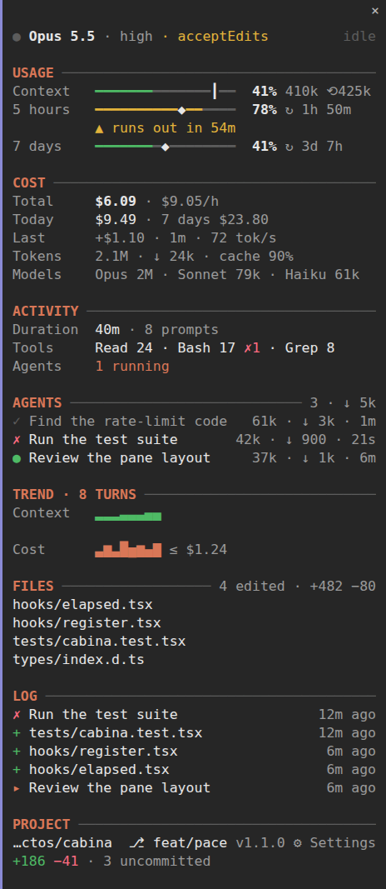
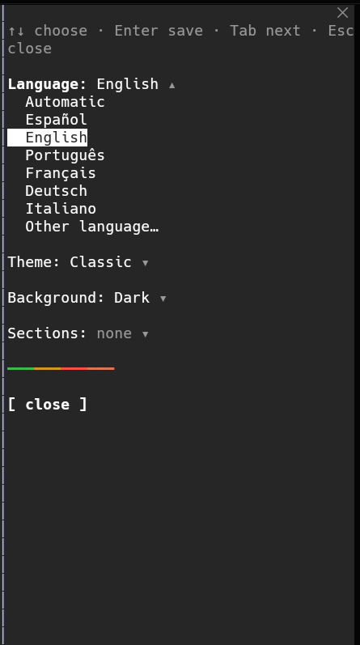
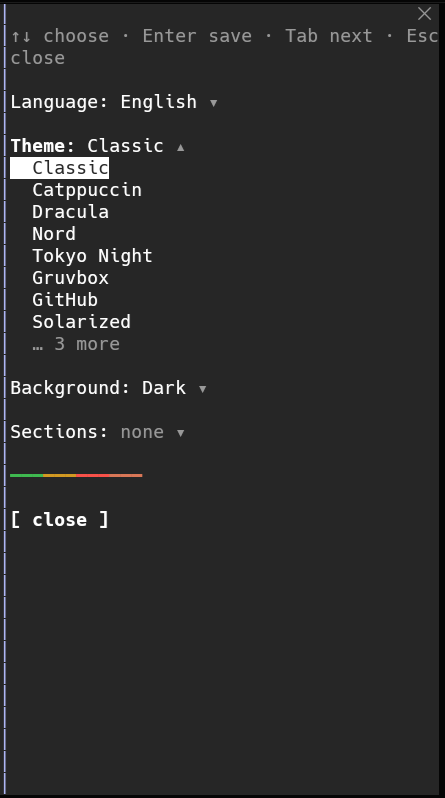
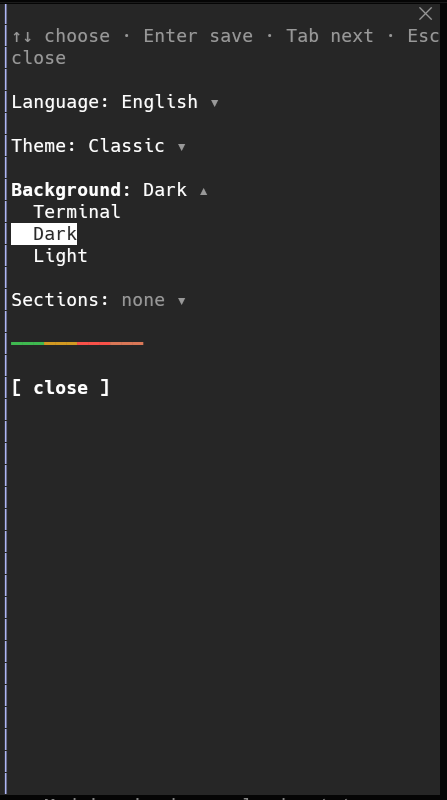
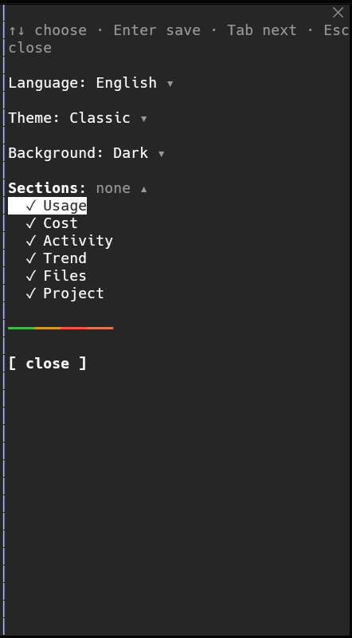

<p align="center"></p>

<h1 align="center">Cabina</h1>

<p align="center"><strong>A clean side pane for Claude Code: everything your session is doing, at a glance.</strong></p>

<p align="center">
  
  
  <a href="LICENSE"></a>
</p>

<p align="center">
  🇪🇸 <a href="README-es.md">Español</a>
</p>

<p align="center">
  <a href="#install"><strong>Install</strong></a> ·
  <a href="#commands">Commands</a> ·
  <a href="#settings">Settings</a> ·
  <a href="#themes">Themes</a> ·
  <a href="#languages">Languages</a>
</p>

---

## 📸 Screenshots

<p align="center">
  
</p>

<table align="center">
  <tr>
    <td align="center"><br><sub>Language</sub></td>
    <td align="center"><br><sub>Theme</sub></td>
    <td align="center"><br><sub>Background</sub></td>
    <td align="center"><br><sub>Sections</sub></td>
  </tr>
</table>

## What it does

Cabina docks a pane beside the conversation that keeps the numbers you usually go looking for: how full the context window is, how close you are to your 5‑hour and 7‑day limits and when they reset, what the session has cost and how fast it is spending, what Claude is doing right now and which files it touched. It updates by itself and stays out of your way. Anything you don't need can be hidden.

## Features

- **Usage**: context window, 5‑hour and 7‑day rate limits with reset countdowns, colored green → amber → red as they fill. A **compact** button shows up past 70 % context.
- **Cost**: session total, spend per hour and what the last turn cost and took.
- **Activity**: session length, prompts sent, most used tools and running subagents.
- **Trend**: sparklines of context and cost per turn.
- **Files**: files edited this session, newest first. Files outside the project are dimmed.
- **Project**: folder, git branch and uncommitted changes (`+120 −34 · 5 uncommitted`).
- **Live status**: model, effort and the tool running now, with a timer.
- **11 themes**, each with a dark **and** a light palette, every color checked for WCAG contrast.
- **Background**: keep the terminal's, or paint the pane dark or light with matching text.
- **Any language**: 6 built in, any other translated once and cached.
- **Show only what you want**: every section can be turned on or off.
- **Adapts to height**: when the pane is short, optional sections step aside instead of being cut.

## Install

Requires Claude Code **2.1.304** or later. Inside Claude Code:

```
/plugin marketplace add SrPirson/cabina
/plugin install cabina@cabina
/reload-plugins
/cabina
```

From a terminal:

```bash
claude plugin marketplace add SrPirson/cabina
claude plugin install cabina@cabina
```

For a single session from a clone:

```bash
git clone https://github.com/SrPirson/cabina
claude --plugin-dir ./cabina
```

**Update**

```bash
claude plugin marketplace update cabina && claude plugin update cabina@cabina
```

**Uninstall**

```bash
claude plugin uninstall cabina@cabina
```

## Commands

| Command | Does |
| --- | --- |
| `/cabina` | Opens the pane |
| `/cabina close` | Closes the pane (`/cabina` opens it again) |
| `/cabina config` | Opens the settings view |
| `/cabina theme <name>` | Switches theme right away, e.g. `/cabina theme dracula` |
| `/cabina language <name>` | Sets the language: a code (`es`, `fr`) or any name (`swahili`, `català`) |
| `/cabina background <auto\|dark\|light>` | Keeps the terminal background or paints the pane |
| `/cabina help` | Lists the commands |

Subcommands also work in other languages: `tema`, `idioma`, `fondo`, `ajustes`…

### Keyboard

| Key | Does |
| --- | --- |
| `Tab` | Moves between the pane's controls (⚙ Settings, compact) |
| `Enter` | Presses the focused control |
| `↑` `↓` | In settings, moves through a list |
| `Enter` | In settings, saves the highlighted choice, or shows/hides a section |
| `Esc` | Gives the keyboard back to the prompt |

## Settings

Open **⚙ Settings** at the bottom of the pane, or run `/cabina config`. Every change applies at once.

| Setting | Values | Default |
| --- | --- | --- |
| Language | `auto`, `es`, `en`, `pt`, `fr`, `de`, `it`, `custom` | `auto` |
| Other language | any language name or code, used with `custom` | — |
| Theme | see [Themes](#themes) | `classic` |
| Background | `auto` (terminal), `dark`, `light` | `auto` |
| Sections | Usage, Cost, Activity, Agents, Trend, Files, Project: on/off each | all on |

The same options appear in `/config`, or in `~/.claude/settings.json`:

```json
{
  "pluginConfigs": {
    "cabina@cabina": {
      "options": {
        "language": "en",
        "theme": "tokyo-night",
        "background": "dark",
        "show_trend": false
      }
    }
  }
}
```

## Themes

| Theme | |
| --- | --- |
| `classic` | Claude Code's own colors; follows your terminal theme |
| `catppuccin` | Mocha on dark, Latte on light |
| `dracula` | Dracula, with an Alucard-style light variant |
| `nord` | Polar Night on dark, Snow Storm on light |
| `tokyo-night` | Night on dark, Day on light |
| `gruvbox` | Gruvbox dark and light |
| `github` | GitHub dark and light |
| `solarized` | Solarized dark and light |
| `colorblind` | Okabe‑Ito palette, safe for protanopia, deuteranopia and tritanopia |
| `contrast` | High contrast |
| `mono` | Monochrome |

Every theme has one palette for dark backgrounds and one for light. With the `auto` background, Cabina picks the one that matches your Claude Code theme. Bars and accents reach at least **3:1** contrast against their background, secondary text **4.5:1** and body text **7:1**, and a test checks all of them.

## Languages

English, Español, Português, Français, Deutsch and Italiano are built in. For any other language, set **Other language** (or `/cabina language swahili`): Cabina asks Claude Haiku once to translate its labels, checks the answer and keeps it for later sessions. If the translation fails, it falls back to English.

`auto` follows Claude Code's own `language` setting.

## Notes

- Cabina reads what Claude Code already knows about the session. It makes no network requests of its own; the only model call is the one-off translation for a language that isn't built in.
- Git data comes from running `git status` and `git diff --shortstat` locally in the session's folder.
- Settings are saved in `~/.claude/settings.json` under `pluginConfigs["cabina@cabina"]`.

---

**Author:** [SrPirson](https://github.com/SrPirson) · MIT License
